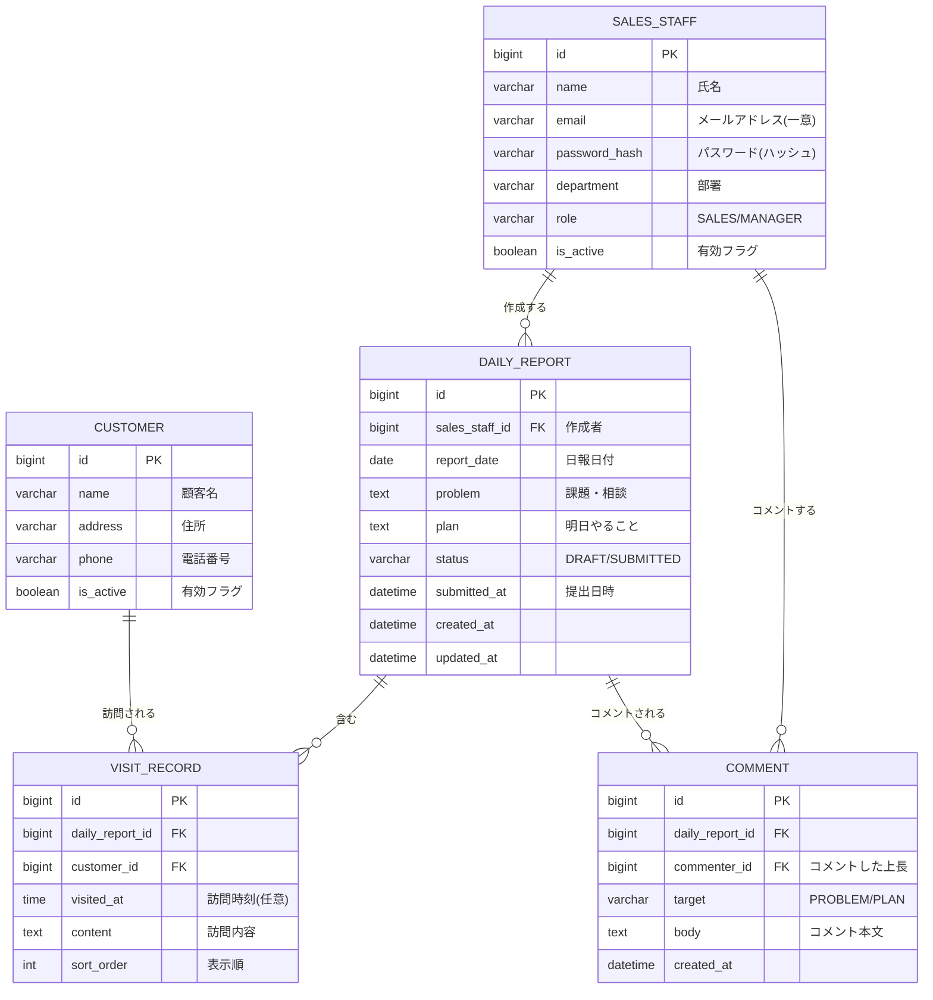

# 営業日報システム 要件定義（叩き台）

※ 仮決め（【想定】）は Issue #1 ですべて確定した。新しい仮決めには【想定】を付け、合意したら外す。

## 1. 目的
- 営業担当者の日々の訪問活動を記録し、上長がタイムリーに状況を把握して助言できるようにする。
- 課題（Problem）と翌日の予定（Plan）を共有し、上長のコメントで営業活動の質を上げる。

## 2. 利用者
| ロール | できること |
|---|---|
| 営業 | 自分の日報を作成・編集・提出、上長のコメントを閲覧 |
| 上長 | 全営業の日報を閲覧し、Problem・Plan にコメント。顧客マスタ・営業マスタの登録・更新。日報は書かない |

上長も営業マスタに登録し、`role`（営業／上長）で区別する。上長と部下の対応は管理しない。

## 3. 機能要件
### 3.1 日報
- 営業は、1日につき1件の日報を作成する（同じ日の日報は2件作れない）。
- 日報には次の内容を書く。
  - 訪問記録（複数行）
  - Problem：今の課題や相談
  - Plan：明日やること
- 日報の状態は「下書き」「提出済み」の2つ。上長が見られるのは提出済みのものだけ。
- 提出後も、本人が修正できる。
- 日報の日付や「当日」は日本時間（Asia/Tokyo）で決める。
- 未来の日付の日報も作成できる。

### 3.2 訪問記録
- 1件の日報に、訪問記録を何行でも追加できる。
- 1行に書く内容：訪問した顧客（顧客マスタから選ぶ）、訪問内容。
- 訪問時刻は任意で入力できる。
- 同じ日に同じ顧客を複数回訪問した場合も、別の行として登録できる。
- 選べるのは有効な顧客だけ。ただし日報を編集するとき、その日報に既に登録されている顧客は、無効になっていてもそのまま残せる。

### 3.3 コメント
- 上長は、営業の日報の Problem と Plan に、それぞれコメントできる。
- 1つの Problem・Plan に、コメントを複数つけられる。
- コメントするのは上長だけ。営業本人の返信機能は今回は作らない。

### 3.4 マスタ管理
- 顧客マスタ：顧客名、住所、電話番号
- 営業マスタ：氏名、メールアドレス、部署、ロール（営業／上長）、パスワード
- 削除はせず、「無効」にする（過去の日報から参照されているため）。
- メールアドレスは大文字・小文字を区別しない（小文字にそろえて保存・照合する）。
- 上長は、自分自身を無効にしたり、自分のロールを営業に変えたりできない（上長が1人もいなくなるのを防ぐため）。

### 3.5 閲覧範囲
- 営業：自分の日報だけ
- 上長：全営業の日報
- 日付・営業担当者・顧客で日報を検索できる。

## 4. 今回の対象外
- 商談・売上の管理（SFA の機能）
- 営業本人の返信、コメントへの「いいね」などのリアクション
- 通知（メール・チャット）
- スマートフォン専用のアプリ

## 5. 非機能要件
- メールアドレスとパスワードでログインした人だけが使える。権限は上の「閲覧範囲」に従う。
- パスワードはハッシュ化して保存する。
- 社内の PC のブラウザから使う。

## 6. ER図

### 設計のポイント
- **日報は「1人1日1件」**：`DAILY_REPORT` の (`sales_staff_id`, `report_date`) に一意制約をつける。
- **訪問記録を別テーブルにする**：1日に何件訪問しても対応できるように、日報と1対多の関係にした。
- **上長は営業マスタの `role` で区別**：上長用のテーブルを別に作らず、営業マスタの `role` 列（SALES/MANAGER）で上長かどうかを判断する。上長と部下の対応は持たない。
- **コメントは1つのテーブルにまとめる**：`target` 列で、Problem と Plan のどちらへのコメントかを区別する。Problem 用と Plan 用でテーブルを分けるより、シンプルになる。

## 7. 決定事項
| No | 内容 | 理由 |
|---|---|---|
| 1 | ログインはメールアドレス＋パスワード。`SALES_STAFF.password_hash` を追加 | 社内 SSO の前提がないため、最小構成にした |
| 2 | マスタ管理は上長（`MANAGER`）が行う。「管理者」ロールは作らない | ロールを増やさずに済む小さな組織を想定 |
| 3 | 上長は日報を書かない | 日報は営業の活動報告であり、上長はコメントする側のため |
| 4 | 【想定】としていた仮決め（日報の状態、提出後の修正、コメントは上長だけ、マスタは無効にする、文字数の上限、ページング など）を、そのまま確定した | Issue #1 で確認。今回の目的（要件定義からテストまでを一通り体験する）には十分なため |
| 5 | 無効になった顧客でも、その日報に既に登録されている訪問記録なら、編集時にそのまま保存できる | 顧客を無効にすると、その顧客を訪問した過去の日報が編集できなくなるのを防ぐため |
| 6 | 自分自身の無効化・ロール変更は `409 CANNOT_MODIFY_SELF` を返す | API 設計のエラーコードに当てはまるものがなかったため |
| 7 | 本人以外が日報を更新しようとしたら 403 を返す（閲覧の 404 とは分ける） | 社内システムで、日報があることが分かっても影響が小さいため |
| 8 | 日付は日本時間（Asia/Tokyo）で決める | 利用者は日本の社内だけのため |
| 9 | 未来の日付の日報も作れる | 制限する理由が今のところないため |
| 10 | メールアドレスは小文字にそろえて保存・照合する | 大文字・小文字の違いで同じ人が二重に登録されたり、ログインできなかったりするのを防ぐため |
