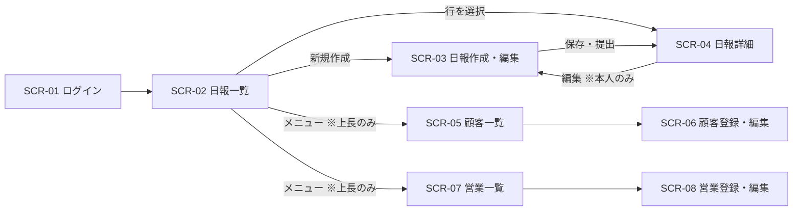

# 営業日報システム 画面定義書（叩き台）

※ 仮決め（【想定】）は Issue #1 ですべて確定した。新しい仮決めには【想定】を付け、合意したら外す。
※ 要件定義・ER図は `sales-daily-report-requirements.md` を参照。

## 1. 画面一覧

| 画面ID | 画面名 | 利用者 | 概要 |
|---|---|---|---|
| SCR-01 | ログイン | 全員 | メールアドレスとパスワードでログインする |
| SCR-02 | 日報一覧 | 営業・上長 | 日報を検索し、一覧で表示する |
| SCR-03 | 日報作成・編集 | 営業 | 訪問記録・Problem・Plan を入力し、保存・提出する |
| SCR-04 | 日報詳細 | 営業・上長 | 日報の内容とコメントを表示する。上長はコメントを書く |
| SCR-05 | 顧客一覧 | 上長 | 顧客マスタを検索・一覧表示する |
| SCR-06 | 顧客登録・編集 | 上長 | 顧客マスタを登録・更新する |
| SCR-07 | 営業一覧 | 上長 | 営業マスタを検索・一覧表示する |
| SCR-08 | 営業登録・編集 | 上長 | 営業マスタを登録・更新する |

マスタ管理は上長が行う（要件定義「7. 決定事項」参照）。

## 2. 画面遷移



## 3. 共通仕様
- ヘッダーに、ログイン中の氏名・メニュー・ログアウトを表示する。
- メニュー：日報一覧（全員）、顧客一覧・営業一覧（上長のみ）。
- 権限のない画面にアクセスした場合は、日報一覧に戻してエラーメッセージを表示する。
- 日付の表示形式は `YYYY/MM/DD`。
- 日付は日本時間で扱う（初期値の「当日」「直近7日間」も日本時間で決める）。

---

## SCR-01 ログイン

```
+--------------------------------+
|        営業日報システム          |
|  メールアドレス [            ]  |
|  パスワード     [            ]  |
|              [ ログイン ]       |
+--------------------------------+
```

| 項目 | 種類 | 必須 | 説明 |
|---|---|---|---|
| メールアドレス | テキスト | ○ | `SALES_STAFF.email` |
| パスワード | パスワード | ○ | `SALES_STAFF.password_hash` と照合 |

| 操作 | 処理 |
|---|---|
| ログイン | 認証に成功したら SCR-02 へ。失敗したら「メールアドレスまたはパスワードが違います」と表示 |

- 無効（`is_active = false`）の営業はログインできない。

---

## SCR-02 日報一覧

```
+------------------------------------------------------------+
| 日付 [2026/11/01]〜[2026/11/08]  営業 [▼全員]  顧客 [▼    ] |
|                                    [ 検索 ]  [ 新規作成 ] |
+------------------------------------------------------------+
| 日付       | 営業   | 訪問件数 | 状態   | コメント数       |
| 2026/11/08 | 鈴木   | 3        | 提出済 | 2                |
| 2026/11/07 | 田中   | 2        | 下書き | 0                |
+------------------------------------------------------------+
```

**検索条件**

| 項目 | 種類 | 初期値 | 説明 |
|---|---|---|---|
| 日付（開始・終了） | 日付 | 直近7日間 | `DAILY_REPORT.report_date` |
| 営業 | プルダウン | 全員 | 上長のみ表示。営業は自分の日報だけが対象 |
| 顧客 | プルダウン | 指定なし | その顧客を訪問した日報に絞り込む |

**一覧の列**

| 列 | 説明 |
|---|---|
| 日付 | `report_date` |
| 営業 | 作成者の氏名 |
| 訪問件数 | `VISIT_RECORD` の件数 |
| 状態 | 下書き／提出済 |
| コメント数 | `COMMENT` の件数 |

| 操作 | 処理 |
|---|---|
| 検索 | 条件で絞り込む。並び順は日付の新しい順 |
| 新規作成 | SCR-03 へ（営業のみ表示） |
| 行を選択 | SCR-04 へ |

- 上長の一覧には、提出済みの日報だけを表示する（下書きは本人だけが見られる）。

---

## SCR-03 日報作成・編集

```
+------------------------------------------------------------+
| 日付 [2026/11/08]                                          |
|                                                            |
| ■ 訪問記録                                                 |
| | 時刻    | 顧客        | 訪問内容                  |    | |
| | [10:00] | [▼ A商事  ] | [新商品の提案。好感触   ] | 削除 | |
| | [14:00] | [▼ B工業  ] | [見積もりの説明         ] | 削除 | |
| [ + 行を追加 ]                                             |
|                                                            |
| ■ Problem（課題・相談）                                    |
| [                                                        ] |
| ■ Plan（明日やること）                                     |
| [                                                        ] |
|                                                            |
|             [ キャンセル ] [ 下書き保存 ] [ 提出 ]          |
+------------------------------------------------------------+
```

| 項目 | 種類 | 必須（提出時） | 形式・桁 | 対応カラム |
|---|---|---|---|---|
| 日付 | 日付 | ○ | 初期値は当日 | `DAILY_REPORT.report_date` |
| 時刻 | 時刻 | − | HH:MM | `VISIT_RECORD.visited_at` |
| 顧客 | プルダウン | ○ | 有効な顧客のみ表示。編集時は、その日報に登録済みの顧客も無効でも表示 | `VISIT_RECORD.customer_id` |
| 訪問内容 | テキストエリア | ○ | 1000文字以内 | `VISIT_RECORD.content` |
| Problem | テキストエリア | ○ | 2000文字以内 | `DAILY_REPORT.problem` |
| Plan | テキストエリア | ○ | 2000文字以内 | `DAILY_REPORT.plan` |

| 操作 | 処理 |
|---|---|
| 行を追加 | 訪問記録の入力行を1行追加する |
| 削除 | その行を削除する |
| 下書き保存 | 入力チェックなしで保存（状態：下書き）。SCR-04 へ |
| 提出 | 入力チェック後に保存（状態：提出済、`submitted_at` を記録）。SCR-04 へ |
| キャンセル | 保存せずに前の画面へ戻る |

**入力チェック**
- 同じ日付の日報が既にある場合：「この日付の日報は作成済みです」
- 提出時、訪問記録が0件の場合：「訪問記録を1件以上入力してください」
- 提出時、必須項目が空の場合：「〇〇を入力してください」

- 訪問記録の表示順は、入力した行の順（`sort_order`）。
- 提出後も本人は編集できる。編集して保存しても状態は提出済のまま。

---

## SCR-04 日報詳細

```
+------------------------------------------------------------+
| 2026/11/08  鈴木  [提出済]                    [ 編集 ]     |
|                                                            |
| ■ 訪問記録                                                 |
| | 10:00 | A商事 | 新商品の提案。好感触              |      |
| | 14:00 | B工業 | 見積もりの説明                    |      |
|                                                            |
| ■ Problem                                                  |
|   B工業の値引き要望にどこまで応じるか相談したい             |
|   ┗ 佐藤（11/08 18:30）: 5%までなら可。明日相談しよう     |
|   [ コメントを入力                    ] [ 送信 ]           |
|                                                            |
| ■ Plan                                                     |
|   A商事へ見積もり送付、C物産へ初回訪問                     |
|   [ コメントを入力                    ] [ 送信 ]           |
|                                                            |
|                                        [ 一覧へ戻る ]      |
+------------------------------------------------------------+
```

| 表示項目 | 説明 |
|---|---|
| ヘッダー | 日付・営業の氏名・状態 |
| 訪問記録 | 時刻・顧客名・訪問内容を `sort_order` 順に表示 |
| Problem / Plan | 本文と、その下にコメント（古い順）。コメントには氏名と日時を表示 |

| 入力項目 | 種類 | 必須 | 形式・桁 | 対応カラム |
|---|---|---|---|---|
| コメント（Problem 用 / Plan 用） | テキストエリア | ○ | 1000文字以内 | `COMMENT.body`、`target` は PROBLEM / PLAN |

| 操作 | 表示条件 | 処理 |
|---|---|---|
| 編集 | 日報の作成者本人 | SCR-03 へ |
| 送信 | 上長、かつ提出済みの日報 | コメントを登録し、画面を再表示 |
| 一覧へ戻る | 全員 | SCR-02 へ |

- コメントの編集・削除はできない。

---

## SCR-05 顧客一覧

```
+------------------------------------------------------------+
| 顧客名 [          ]  [ ] 無効も表示   [ 検索 ] [ 新規登録 ] |
+------------------------------------------------------------+
| 顧客名  | 住所             | 電話番号      | 状態 |        |
| A商事   | 東京都千代田区…  | 03-xxxx-xxxx  | 有効 | [編集] |
+------------------------------------------------------------+
```

| 操作 | 処理 |
|---|---|
| 検索 | 顧客名の部分一致で絞り込む。初期表示は有効な顧客のみ |
| 新規登録 | SCR-06（新規）へ |
| 編集 | SCR-06（編集）へ |

---

## SCR-06 顧客登録・編集

| 項目 | 種類 | 必須 | 形式・桁 | 対応カラム |
|---|---|---|---|---|
| 顧客名 | テキスト | ○ | 100文字以内 | `CUSTOMER.name` |
| 住所 | テキスト | − | 200文字以内 | `CUSTOMER.address` |
| 電話番号 | テキスト | − | 数字とハイフン | `CUSTOMER.phone` |
| 状態 | ラジオ | ○ | 有効／無効 | `CUSTOMER.is_active` |

| 操作 | 処理 |
|---|---|
| 保存 | 入力チェック後に保存し、SCR-05 へ |
| キャンセル | 保存せずに SCR-05 へ |

- 削除ボタンは置かない。使わなくなった顧客は「無効」にする。

---

## SCR-07 営業一覧

```
+------------------------------------------------------------+
| 氏名 [          ]  [ ] 無効も表示   [ 検索 ] [ 新規登録 ]   |
+------------------------------------------------------------+
| 氏名 | メールアドレス     | 部署   | ロール | 状態 |        |
| 鈴木 | suzuki@example.com | 営業1課 | 営業   | 有効 | [編集] |
+------------------------------------------------------------+
```

| 操作 | 処理 |
|---|---|
| 検索 | 氏名の部分一致で絞り込む。初期表示は有効な営業のみ |
| 新規登録 | SCR-08（新規）へ |
| 編集 | SCR-08（編集）へ |

---

## SCR-08 営業登録・編集

| 項目 | 種類 | 必須 | 形式・桁 | 対応カラム |
|---|---|---|---|---|
| 氏名 | テキスト | ○ | 50文字以内 | `SALES_STAFF.name` |
| メールアドレス | テキスト | ○ | メール形式、重複不可（大文字・小文字は区別しない） | `SALES_STAFF.email` |
| 部署 | テキスト | − | 50文字以内 | `SALES_STAFF.department` |
| ロール | ラジオ | ○ | 営業／上長 | `SALES_STAFF.role` |
| パスワード | パスワード | 新規時○ | 8文字以上。編集時は空なら変更しない | `SALES_STAFF.password_hash`（ハッシュ化して保存） |
| 状態 | ラジオ | ○ | 有効／無効 | `SALES_STAFF.is_active` |

| 操作 | 処理 |
|---|---|
| 保存 | 入力チェック後に保存し、SCR-07 へ |
| キャンセル | 保存せずに SCR-07 へ |

- メールアドレスが既に登録されている場合：「このメールアドレスは登録済みです」
- 自分自身を無効にしたり、自分のロールを営業に変えたりした場合：「自分自身を無効にしたり、ロールを営業に変えたりすることはできません」
- 削除ボタンは置かない。退職者などは「無効」にする。
